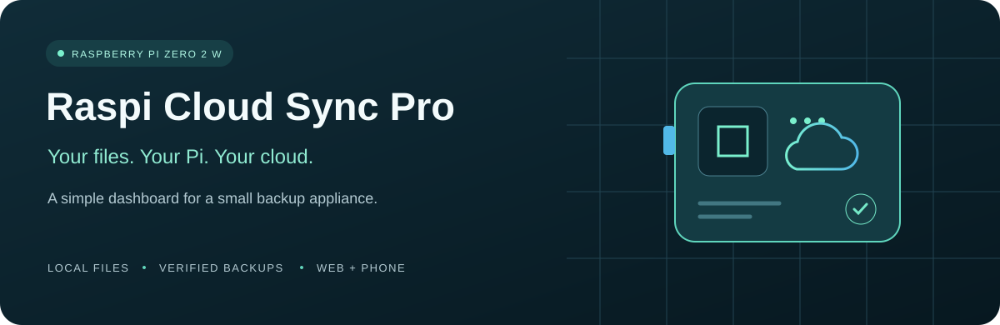
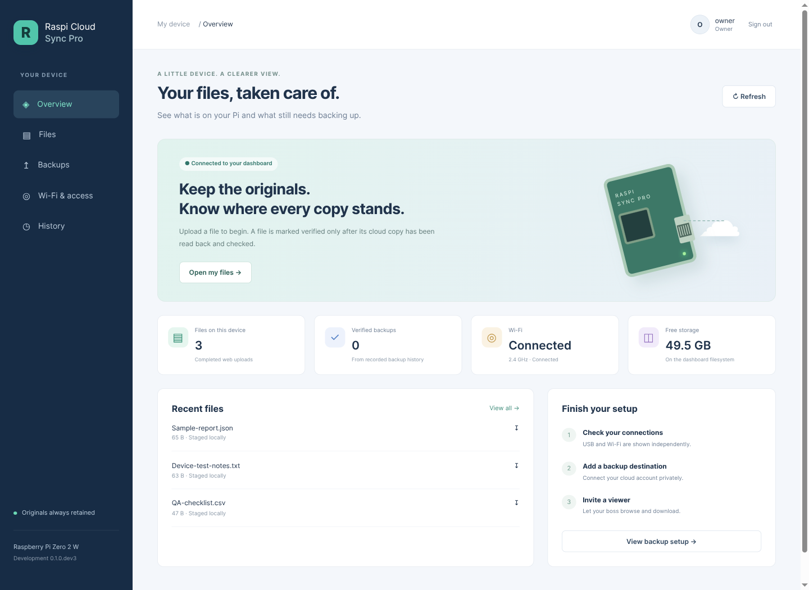
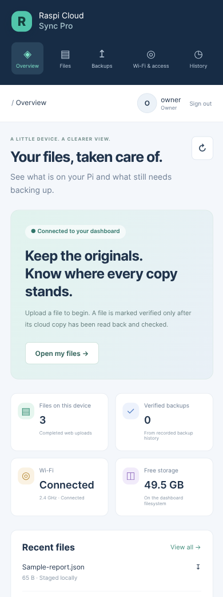

<div align="center">



# Raspi Cloud Sync Pro

**A smart USB flash drive for Raspberry Pi Zero 2 W — under development.**

Copy files in Windows · Keep local originals · Back up over built-in Wi-Fi

[](https://github.com/rtariq2015/raspi-cloud-sync-pro/actions/workflows/tests.yml)
[](LICENSE)
[](docs/STATUS.md)

**[Live project progress](docs/STATUS.md)** · [Dashboard guide](docs/DASHBOARD.md) · [Feature plan](docs/PRODUCT_PLAN.md) · [Roadmap](docs/ROADMAP.md)

</div>

> **Automatic USB-to-Google test passed — 14 November 2026.** Three files,
> including a 64 MiB file, were copied onto CLOUDSTICK from the Zorin laptop.
> Normal Eject triggered safe capture, USB reattachment, Google upload and
> downloaded-content verification automatically. Local copies remain. Windows
> acceptance, duplicate local capture prevention and physical outage/reboot tests
> are still outstanding. [Exact results](docs/CORE_RECOVERY.md) ·
> [Plain-language updates and questions](https://github.com/rtariq2015/raspi-cloud-sync-pro/issues/2).

## The core product comes first

1. Plug into Windows and appear as a genuine USB storage drive; Windows assigns its letter.
2. Copy files normally, without installing a Windows application.
3. Capture only under verified safe filesystem ownership; retain files when offline.
4. Upload over the Pi's built-in Wi-Fi into the selected Google Drive folder.
5. Verify uploaded contents, retry failures and avoid repeating verified versions.

The writable-drive/capture/upload test now passes automatically after safe eject
on a real Linux USB host. Windows-specific acceptance remains outstanding.
A quiet period cannot prove host caches are flushed or
files are complete. Classic mass storage currently requires a clean host eject
before Pi-side staging. Eliminating that requirement is a research target, not
an implemented guarantee. The OS and existing files are being preserved.

The Zero 2 W's single USB OTG controller serves the Windows connection in gadget
mode; a conventional USB Wi-Fi adapter cannot use that same controller as a host
at the same time. Use built-in Wi-Fi for this design.

## Optional dashboard preview

See your files, open a text preview, download a copy, and follow backup history
from one interface. Owners can upload; viewers can browse and download.



The screenshots show the real Pi preview, with disposable QA files. The Wi-Fi
address is replaced with a generic label. No cloud backup is claimed in this view.

## Built for the way you work

**Plug in.** The intended everyday mode uses one USB data cable for power and
genuine mass storage. USB Ethernet/Samba remains an optional alternative; it does
not satisfy the requested flash-drive interface. The first disposable-image
mass-storage trial has accepted real host copies, including an automatic Linux-host test.

**Keep a local copy.** Completed files stay on the Pi when an approved Internet
connection is unavailable. The backup engine queues jobs and retries; it never
automatically deletes originals or staged files.

**Back up with evidence.** Koofr WebDAV, Google Drive and Dropbox use rclone adapters with
separate jobs per destination. “Verified” means remote contents were downloaded
and checked against SHA-256. Real Google browser authorization and one controlled
QA-file backup have passed on the Pi. Koofr and Dropbox real-account tests remain.
The web folder/test/enable workflow is unfinished. Separately, the approved USB
trial now runs a persistent Google worker for completed local batches; its first
real USB files passed upload and downloaded-content verification.

**Open it from your phone.** The same dashboard adapts to a small screen. Remote
browser access uses HTTPS and login; your manager will not need Tailscale. The
preview now has a fixed free tunnel address; its login page passes public HTTP
and browser checks. Persistent services are installed and enabled; a real reboot,
off-LAN phone use and physical Android installation remain to be accepted.
See [remote access](docs/REMOTE_ACCESS.md).

<p align="center">
  
</p>

## Where the project stands

| Working and tested | Next acceptance step |
| --- | --- |
| Home Wi-Fi and authenticated SSH | Reboot and long-duration checks |
| Dashboard, owner/viewer roles, password changes/recovery and file access | Invitations and broader file browsing |
| Authenticated HTTPS preview; fixed-address login page and enabled persistent services | Actual reboot, off-LAN phone and Android web-app installation |
| Automatic Linux USB eject → capture → reattach → verified Google backup | Windows, persistent USB startup, outage/reboot and duplicate-capture acceptance |
| Fresh owner-requested Google preparation through the persistent watcher | Live Test/Enable and recurring backup acceptance |
| Opt-in completed-batch worker and small Rust scheduler | Guided cloud enablement, persistent worker and sustained-load acceptance |
| Guarded USB controller; actual Samba locking on the Pi | Windows/USB host transfers, host behavior and power-loss tests |
| Enterprise Wi-Fi validation and non-secret configuration plans | Approved enterprise certificates and on-network testing |
| Appliance image and update design | Image build, first-boot setup and signed updates with rollback |

**810 core Python tests and 28 hardware-free USB operator tests pass locally.**
The existing Rust suite has 11 tests; Rust source is unchanged. Python tests include actual
rclone against temporary local storage. Automated checks, simulated hardware,
physical Pi checks and real cloud tests are recorded separately in the
[validation record](docs/VALIDATION.md).

The optional web preview supports Google sign-in and owner-requested preparation
through a persistent setup service. The fresh request after restoring the fixed
website address now reaches **Configuration prepared · Test required**. This
creates a disabled local configuration; a cloud test and explicit enablement
still follow. Existing accounts and files stay preserved.
[Google setup](docs/CLOUD_SETUP.md).

The actual Samba reader and safe version staging now pass an encrypted SMB 3.1.1
trial on the Pi, including busy writers, interrupted copies and retained older
versions. This qualifies the local reader, with Windows drive mapping still
pending. [Pi trial evidence](docs/acceptance/pi-smb-sdk17-core-dev14-2026-11-14.json).

Development also contains the guarded cloud worker, retries, independent
read-back verification, the private upload bootstrap and a coordinator for one
selected completed batch. Pending owner controls now have event/recovery
service examples. The dev17 package is installed inactive on the Pi; its new
control and upload services remain off. Dev18 source also connects
completed web-file transfer to the selected-batch dispatcher. Native acceptance,
recurring scheduling and file-status reporting remain for that web-driven path.
The new USB trial instead uses the existing operator-enabled staged worker.
Follow [Project progress](docs/STATUS.md)
for the current deployment and [the implementation guide](docs/GOOGLE_CONTROLS.md)
for the developer details.

The reported small-file upload error is fixed on the Pi. Isolated authenticated
tests accepted 122,700-byte, 125,645-byte and 1 MiB files with identical downloaded
copies; the file limit remains 100 MiB.
[Upload repair evidence](docs/acceptance/pi-dashboard-upload-dev11-2026-11-14.json).

The dashboard currently lists completed **web uploads**. Broader file browsing,
the Samba-to-dashboard bridge and dashboard status for the USB worker remain in development.

## USB storage first; network sharing remains optional

**What appears on the computer today?** The approved Pi trial presents a genuine
writable USB mass-storage disk labelled CLOUDSTICK. Automatic copying/eject
acceptance passes on Zorin Linux. Earlier Windows attribution relied on context
and is not independently verified. The [core acceptance record](docs/CORE_RECOVERY.md)
separates that test from earlier dashboard and Samba work.

**USB mass storage — primary product mode.** The computer sees a traditional
flash drive. New-file staging waits for a coordinated flush/eject and verified
exclusive Pi access. A quiet period cannot prove a file is complete, and a
read-only mount cannot make concurrent host writes safe. Modes are not enabled
together. See [the USB architecture](docs/PHASE2.md).

**USB Ethernet + Samba — optional alternative.** Linux owns the filesystem.
Network file operations permit live staging without sharing a writable block
filesystem. It uses a mapped network drive rather than a normal USB flash drive.
Use `config/device.ethernet-samba.example.json` to plan that mode explicitly.

## Start here

- **Following progress on your phone?** Open [Project progress](docs/STATUS.md).
- **Trying the dashboard?** Follow [Dashboard setup](docs/DASHBOARD.md); it runs
  on loopback with privately created accounts and no default password.
- **Opening it away from home?** Read [Remote access](docs/REMOTE_ACCESS.md) for
  fixed free addresses, tunnel outages and startup requirements.
- **Installing on another Pi?** Use [Replication](docs/REPLICATION.md). A complete
  appliance image is [planned](docs/APPLIANCE_IMAGE.md), not available to flash yet.
- **Preparing a hardware trial?** Read [Pi test guide](docs/PI_TEST_GUIDE.md) and
  [the existing connectivity baseline](docs/PI_CONNECTIVITY.md).
- **Contributing?** Read [Contributing](CONTRIBUTING.md),
  [Architecture](docs/ARCHITECTURE.md) and [Backup worker](docs/STAGED_WORKER.md) and [Private cloud setup](docs/CLOUD_SETUP.md).

Historical scripts under `src/home/pi/` and guides under `doc/` are preserved
upstream material. They are quarantined and are not current installation steps.
No current installer formats a disk, exposes the live root filesystem or replaces
a working network configuration.

<details>
<summary><strong>Developer quick checks</strong></summary>

Use Python 3.9+ and a virtual environment. Optional SMB support requires Python
3.10+. Rust tooling is isolated in the [documented build container](docs/RUST_EVALUATION.md).
The small Rust watcher measured 1,796 KiB idle parent RSS with a fixture runner;
this is not a whole-appliance memory guarantee.

```sh
python3 -m venv .venv
.venv/bin/python -m pip install '.[dashboard]'
.venv/bin/python -m unittest discover -s tests -v
.venv/bin/raspi-cloud-sync-pro status
.venv/bin/raspi-cloud-sync-pro network-status
```

The hardware gate remains disabled. Tests use temporary files and simulated
devices; the optional local-rclone test needs `RASPI_TEST_RCLONE` set to an
installed executable. No test mounts an image or formats hardware.

</details>

Development commits stay on `development`. Main-branch merges and release
publication require owner approval.

## Credits and license

**Koseng created [RaspiAsUSBStickWithCloudSync](https://github.com/Koseng/RaspiAsUSBStickWithCloudSync),
the Raspberry Pi USB mass-storage and cloud-sync foundation of this project.**
Its complete Git ancestry, original source locations and original
[GPL-3.0 license](LICENSE) are preserved. The original README is retained exactly
as [README.upstream.md](README.upstream.md). This derivative remains GPL-3.0.
See [the upstream review](docs/UPSTREAM_REVIEW.md) for provenance and safety changes.

The optional external USB Ethernet provider is **Raspberry Pi Ltd.'s rpi-usb-gadget**
(Apache-2.0). See [third-party notices](THIRD_PARTY_NOTICES.md) for its credits and
other optional components. Dashboard screenshots and the simple project icon
were created for this project.

[Cloud Stick Pro](https://github.com/rtariq2015/cloud-stick-pro) is a separate,
unchanged feature/design reference. No code, assets, history or credentials from
it were imported. Automatic original-file and staged-folder deletion remain off.
