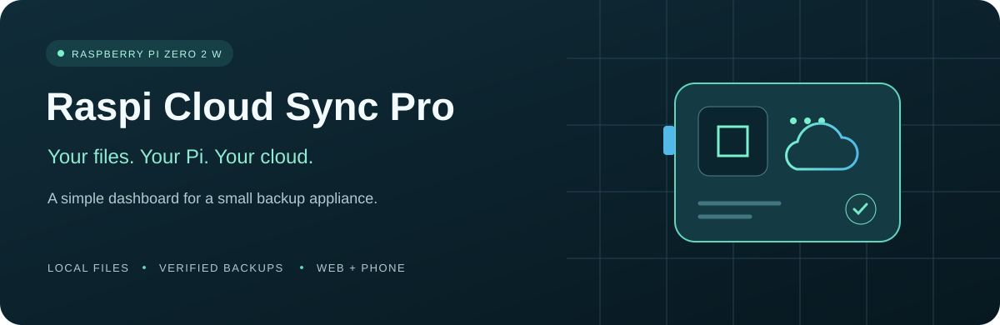
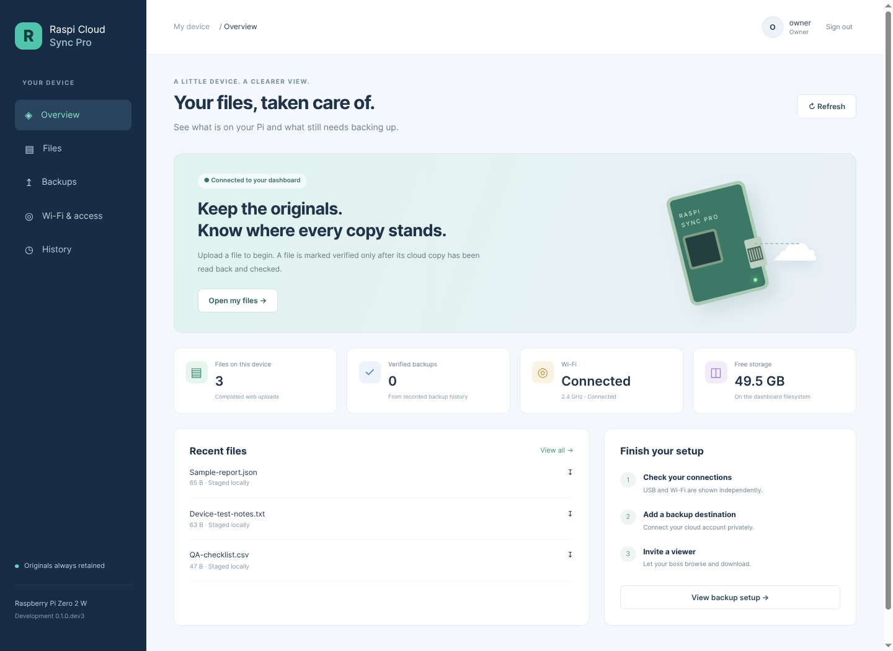
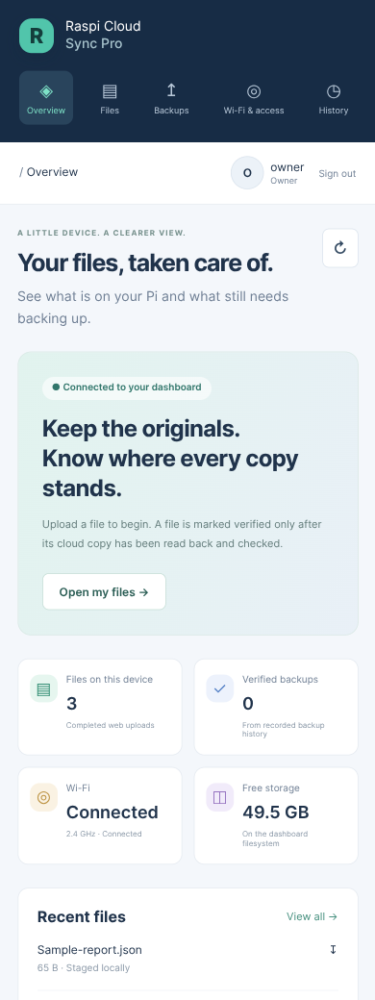

<div align="center">



# Raspi Cloud Sync Pro

**Turn a Raspberry Pi Zero 2 W into a file hub you can reach from your browser.**

Local storage · Verified cloud backups · Desktop and phone dashboard

[](https://github.com/rtariq2015/raspi-cloud-sync-pro/actions/workflows/tests.yml)
[](LICENSE)
[](docs/STATUS.md)

**[Live project progress](docs/STATUS.md)** · [Dashboard guide](docs/DASHBOARD.md) · [Feature plan](docs/PRODUCT_PLAN.md) · [Roadmap](docs/ROADMAP.md)

</div>

> **Development preview — 13 November 2026.** The dashboard runs on a real Pi,
> and authenticated access through a temporary HTTPS tunnel has passed testing.
> Real cloud-account backups, Samba hardware acceptance and a ready-to-flash
> image are still ahead. No production release has been published.

## Meet your dashboard

See your files, open a text preview, download a copy, and follow backup history
from one interface. Owners can upload; viewers can browse and download.



The screenshots show the real Pi preview, with disposable QA files. The Wi-Fi
address is replaced with a generic label. No cloud backup is claimed in this view.

## Built for the way you work

**Plug in.** The intended everyday mode uses one USB data cable for power and
Ethernet. Your computer accesses files through an authenticated Samba network
drive while the Pi retains filesystem ownership. Actual share acceptance is pending.

**Keep a local copy.** Completed files stay on the Pi when an approved Internet
connection is unavailable. The backup engine queues jobs and retries; it never
automatically deletes originals or staged files.

**Back up with evidence.** Koofr WebDAV and Google Drive use rclone adapters with
separate jobs per destination. “Verified” means remote contents were downloaded
and checked against SHA-256. Real account authorization and acceptance are pending.

**Open it from your phone.** The same dashboard adapts to a small screen. Remote
browser access uses HTTPS and login; your manager will not need Tailscale. The
current tunnel is temporary. Stable hosting and physical Android installation
remain to be accepted.

<p align="center">
  
</p>

## Where the project stands

| Working and tested | Next acceptance step |
| --- | --- |
| Home Wi-Fi and authenticated SSH | Stable USB addressing, reboot and long-duration checks |
| Dashboard, owner/viewer roles, password changes/recovery and file access | Invitations and broader file browsing |
| Authenticated public HTTPS preview | Stable hostname, off-LAN phone and Android web-app installation |
| Versioned backup engine, retries and independent read-back verification | Private Koofr and Google Drive test accounts |
| Opt-in completed-batch worker and small Rust scheduler | Real cloud accounts and sustained-load acceptance |
| Guarded USB controller; actual Samba protocol-lock fixture | Pi/Windows share locks, host behavior and power-loss tests |
| Enterprise Wi-Fi validation and non-secret configuration plans | Approved enterprise certificates and on-network testing |
| Appliance image and update design | Image build, first-boot setup and signed updates with rollback |

**177 Python tests and 10 Rust tests pass locally.** Python tests include actual
rclone against temporary local storage. Automated checks, simulated hardware,
physical Pi checks and real cloud tests are recorded separately in the
[validation record](docs/VALIDATION.md).

The dashboard currently lists completed **web uploads**. It does not yet browse
all Pi folders or start cloud backup automatically. The Rust trial measured
1,796 KiB idle parent RSS with a fixture runner; it is not a whole-appliance
memory guarantee. See [the measurements and language decision](docs/RUST_EVALUATION.md).

## Two USB modes, one clear ownership rule

**USB Ethernet + Samba — preferred for continuous backups.** Linux owns the
filesystem. Network file operations allow controlled staging without sharing a
writable block filesystem with the computer. Planned Windows access includes a
mapped drive such as `Z:`.

**USB mass storage — compatibility option.** The computer sees a traditional
flash drive. New-file staging waits for a coordinated flush/eject and verified
exclusive Pi access. A quiet period cannot prove a file is complete, and a
read-only mount cannot make concurrent host writes safe. Modes are not enabled
together. See [the USB architecture](docs/PHASE2.md).

## Start here

- **Following progress on your phone?** Open [Project progress](docs/STATUS.md).
- **Trying the dashboard?** Follow [Dashboard setup](docs/DASHBOARD.md); it runs
  on loopback with privately created accounts and no default password.
- **Installing on another Pi?** Use [Replication](docs/REPLICATION.md). A complete
  appliance image is [planned](docs/APPLIANCE_IMAGE.md), not available to flash yet.
- **Preparing a hardware trial?** Read [Pi test guide](docs/PI_TEST_GUIDE.md) and
  [the existing connectivity baseline](docs/PI_CONNECTIVITY.md).
- **Contributing?** Read [Contributing](CONTRIBUTING.md),
  [Architecture](docs/ARCHITECTURE.md) and [Backup worker](docs/STAGED_WORKER.md) and [Private cloud setup](docs/CLOUD_SETUP.md).

Historical scripts under `src/home/pi/` and guides under `doc/` are preserved
upstream material. They are quarantined and are not current installation steps.
No current installer formats a disk, exposes the live root filesystem or replaces
a working network configuration.

<details>
<summary><strong>Developer quick checks</strong></summary>

Use Python 3.9+ and a virtual environment. Optional SMB support requires Python
3.10+. Rust tooling is isolated in the [documented build container](docs/RUST_EVALUATION.md).

```sh
python3 -m venv .venv
.venv/bin/python -m pip install '.[dashboard]'
.venv/bin/python -m unittest discover -s tests -v
.venv/bin/raspi-cloud-sync-pro status
.venv/bin/raspi-cloud-sync-pro network-status
```

The hardware gate remains disabled. Tests use temporary files and simulated
devices; the optional local-rclone test needs `RASPI_TEST_RCLONE` set to an
installed executable. No test mounts an image or formats hardware.

</details>

Development commits stay on `development`. Main-branch merges and release
publication require owner approval.

## Credits and license

**Koseng created [RaspiAsUSBStickWithCloudSync](https://github.com/Koseng/RaspiAsUSBStickWithCloudSync),
the Raspberry Pi USB mass-storage and cloud-sync foundation of this project.**
Its complete Git ancestry, original source locations and original
[GPL-3.0 license](LICENSE) are preserved. The original README is retained exactly
as [README.upstream.md](README.upstream.md). This derivative remains GPL-3.0.
See [the upstream review](docs/UPSTREAM_REVIEW.md) for provenance and safety changes.

The optional external USB Ethernet provider is **Raspberry Pi Ltd.'s rpi-usb-gadget**
(Apache-2.0). See [third-party notices](THIRD_PARTY_NOTICES.md) for its credits and
other optional components. Dashboard screenshots and the simple project icon
were created for this project.

[Cloud Stick Pro](https://github.com/rtariq2015/cloud-stick-pro) is a separate,
unchanged feature/design reference. No code, assets, history or credentials from
it were imported. Automatic original-file and staged-folder deletion remain off.
