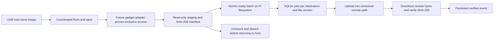
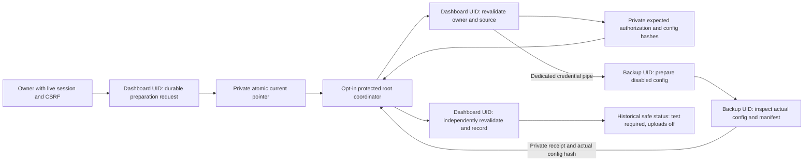

# Architecture

Phase 2 adds the guarded device and sharing layers described in
[PHASE2.md](PHASE2.md). USB Ethernet plus authenticated Samba is the preferred
continuous-backup mode; mass storage remains an explicit-eject compatibility mode.
The Phase 1 core and its guarantees below remain in use.

The package in `src/raspi_cloud_sync_pro/` evolves Koseng's image → local transfer
directory → upload design into explicit boundaries. The original source remains
in `src/home/pi/`; Dropbox/SCP helpers are preserved with documented safety
quarantine. New code does not import those service loops.

| File | Implemented responsibility |
| --- | --- |
| `storage.py` | Fail-closed ownership model; requires clean host release, closed gadget/drained I/O, read-only access, and successful unmount/detach evidence |
| `staging.py` | Full recursive inventory, descriptor-based no-symlink reads, streamed SHA-256, source-change checks, space reserve, flushed files/manifest and atomic ready publication |
| `history.py` | SQLite schema version 1, transactional jobs and events, destination/version deduplication, atomic claims, OS worker lock, interrupted-job recovery and read-only history |
| `engine.py` | One attempt at a time; distinct upload/verification events; capped exponential backoff; network/metered gating; retain every source/staged file |
| `providers.py` | Explicitly enabled rclone adapter; bounded copies, immutable version paths and downloaded-content SHA-256 verification |
| `network.py` | Non-secret personal/enterprise profile validation and connectivity policy; no OS changes |
| `config.py`, `cli.py` | Strict planning schema, diagnostics and opt-in completed-batch worker commands |
| `accounts.py` | Private durable account writes, explicit recovery, role preservation and credential-based session revocation |
| `cloud_readiness.py` | Local-only rclone backend metadata checks; no account or cloud activation claim |
| `google_destination.py` | Private OAuth handoff across separate identities and no-replace, disabled Google rclone preparation; no cloud requests |
| `google_setup.py` | Durable owner preparation intent, source/credential bindings, consumed private export and strict historical receipt projection |
| `google_broker.py` | Opt-in protected-root coordinator with ordinary source/backup children, private source/config hash checks and bounded preparation only |
| `google_operational.py` | Disabled operational config generations with independent source bindings and separate mutable token storage; no network or worker integration |
| `google_control.py` | Durable owner Test/Enable/Disable decisions and fresh per-batch admission records; local coordination only, with no cloud or service operations |
| `google_control_runner.py` | Pending-request eligibility over an ordinary-identity private channel; skips completed work and invokes the separately gated coordinator at most once |
| `google_test.py` | Default-denied private Google fixture worker with a root-peer release gate, strict mutable settings, forced token refresh and downloaded-content verification; live activation pending |
| `google_test_broker.py` | Opt-in protected root Test coordinator with fresh source/network/kernel authority, private channels, scoped cleanup and historical receipts; live activation pending |
| `google_test_executor.py` | Ordinary backup-UID bootstrap, credential-free canaries, same-PID Test CLI and live completion barrier; live activation pending |
| `google_upload.py` | Default-denied selected-batch upload API; fresh owner admission, separate root release, generation-scoped jobs and downloaded-content verification; live activation pending |
| `google_upload_executor.py` | Ordinary backup-UID upload bootstrap; authenticated inherited channels, credential-free canaries, request binding and a live receipt-completion barrier; live activation pending |
| `google_upload_dispatcher.py` | Default-disabled root coordinator for one selected, already-transferred batch; fresh admission, read-only staging, actual confinement and private receipt/completion checks; live activation pending |
| `google_web_upload_pipeline.py` | Transfers one selected completed web batch between ordinary identities, requires both clean child exits and cleanup, then invokes the separately gated dispatcher; source-only |
| `wifi_confinement.py` | Read-only held inspection of current systemd RNI ingress/egress attachments and exact shared allowlist maps; no credential authority |
| `batch_transfer.py` | Private descriptor-based streaming of selected completed web batches between service identities; hashes, completion framing and retained partials |
| `dashboard.py`, `templates/`, `static/` | Optional authenticated Flask/Waitress UI and PWA foundation, owner/viewer roles, bounded file access; no network/gadget mutation endpoints |
| `staged_worker.py`, `rust/` | Opt-in ready-batch reconciliation/scheduling and per-destination jobs; no live image access |
| `wifi_plan.py` | Non-secret inactive NetworkManager profile plans; no OS mutation |
| `web_ingest.py` | Pi-owned HTTP ingress, streaming hashes, size/space limits, retained incomplete uploads and atomic ready publication |

## Data flow

The new [Google control and transfer components](GOOGLE_CONTROLS.md) have
source-tested owner dashboard controls, a default-denied private tester and a
separate per-batch upload API.
They are not yet deployed or connected to a live recurring cloud executor.

The ownership class serializes local transitions but is not a kernel lock,
cross-process device controller, or observation of host caches. Its booleans must
eventually come from a trusted hardware adapter. A fresh process starts unknown.
There is no automatic recovery to host ownership after an error.

## Staging contract

Only a trusted, exclusively owned, read-only source may be staged. The API is
intended for the future storage controller; no CLI can assert those conditions
for a real image. Service-owned source/destination ancestor directories must be
trusted and stable. No-follow descriptor traversal prevents source file/directory
symlinks being followed; it does not prevent a privileged process remounting or
replacing trusted roots. The gadget adapter remains essential.

Each `.incomplete` batch has `files/` plus `manifest.json`; successful publication
renames it to `.ready` after flushing files, directories and manifest. Failed
and incomplete batches stay on disk and cannot enter the queue. A low-space
preflight reserves 16 MiB by default; actual I/O errors still fail safely. Full
recursive inventory replaces upstream's timestamp cursor and two-directory
limit. A path/size/SHA-256 identifies file contents; timestamps alone do not.

## Jobs and remote versions

The queue has one job for each destination, relative path and SHA-256. Duplicate
snapshots do not repeat completed jobs. Changed content gets a distinct job and
`versions/<sha256>/<relative-path>` destination, retaining earlier versions.
Deleting a source never deletes remote data. Empty directories are staged but
have no upload jobs; empty files do have jobs.

States are queued → uploading → uploaded → verifying → verified, with retry
and failed outcomes. Each transition appends an event. A retry uses the same
version path; an interrupted attempt is never promoted to verified. Three
attempts and 30-second base backoff are defaults, capped at one hour. Syntax,
fatal and no-retry rclone errors fail; transient errors use the scheduler.
One `flock` worker holds the database lock through the attempt and recovery.
External writers must respect that lock; direct database edits are unsupported.

Rclone runs with argument arrays, an explicit protected config, one transfer/
checker, small buffers, a hard process timeout and no shell. Ambient `RCLONE_*`
overrides are removed except the encrypted-config password variable; inherited
proxy and CA settings are retained. Raw provider output is discarded. The adapter
uses [`copyto`](https://rclone.org/commands/rclone_copyto/) with `--immutable` and
`--checksum`, then [`checksum sha256 --download`](https://rclone.org/commands/rclone_checksum/)
against the manifest. Upload exit success alone never records verification.

## Limits and next integration work

Phase 2 now supplies code-gated controller/share runtimes and a Linux gadget
backend, plus an external official Ethernet provider integration. None is enabled
by default. NetworkManager provisioning and a web dashboard still require review;
there is no live mode switch. See [the device design](PHASE2.md).
The queue retries whole files, not partial-upload sessions; large files may need
a later resumable provider implementation. Terminal failed jobs require future
explicit recovery tooling; re-enqueueing an identical version does not silently
reset them. Existing verified history describes a past check, not continuous
remote monitoring. Deleted/corrupted verified remote objects need a later audit
and repair workflow. Corrupt immutable destinations are not overwritten.

SQLite and manifests live on the Pi filesystem, separate from the USB image.
Use a restricted service-owned state directory; back up the database and staging
together when no worker is running. History schema migrations, all-disk-full
database recovery, cancellation, a long-running scheduler and durable hardware
ownership recovery remain work before deployment. File payloads are streamed;
manifest/job metadata scales with inventory size and still needs Pi benchmarking.

## Dashboard boundary

The dashboard binds to loopback and is intended to run under an unprivileged
identity behind a reviewed HTTPS proxy for remote browser access. Local accounts
use scrypt hashes; sessions expire and are revoked server-side on logout/restart.
POST requests require a CSRF token. It never accepts arbitrary commands, paths,
network profiles or gadget actions from a browser. Private data is not cached by
the PWA worker. Browser file names/content are rendered as text.

HTTP uploads enter a separate private inbox, not the Samba source tree or a USB
image. Only a complete received stream with flushed payload/manifest becomes a
ready batch. This gives HTTP its own completion protocol without bypassing Samba
deny-write locks or mass-storage ownership. Uploads are retained locally while
cloud configuration/scheduler work remains incomplete. The status UI reports that
limit and does not manufacture verification events. See [DASHBOARD.md](DASHBOARD.md)
and [PRODUCT_PLAN.md](PRODUCT_PLAN.md).

## Private Google authorization boundary

Dev9 separates dashboard-owned browser authorization from backup-owned rclone
configuration. Its operator exporter/importer passed a synthetic two-identity CLI
trial on the Pi; this did not connect real dashboard credentials to production
backup state. The earlier one-file Google proof on dev8 describes a separate
historical QA configuration and job. Neither verifies a new destination.
The protected dev10 dashboard and request watcher previously ran on the Pi. Its
real owner HTTPS form prepared a private configuration across these identities,
with uploads disabled and a cloud test still required. The watcher was transient
and disappeared on reboot. The replacement preparation watcher is now persistent
and uses the protected dev14 broker at the current fixed origin. The live dev11
dashboard permits Prepare requests. A fresh owner form request now passes,
with independent offline source/configuration checks across both identities.
Control requests and automatic uploads remain disabled. Existing authorization
and historical configurations are retained.
[Restoration](acceptance/pi-google-prepare-restoration-dev14-2026-11-14.json).
[Fresh preparation](acceptance/pi-google-prepare-fresh-dev14-2026-11-14.json).
[Live acceptance](acceptance/pi-google-setup-live-dev10-2026-11-13.json).
The owner-intent and broker boundary follows. Its
native synthetic HTTP-handler/root-broker and recovery trial now passes on the
Pi, with [separate evidence](acceptance/pi-google-setup-dev10-2026-11-13.json).
Actual systemd path/sandbox and live preparation have separate records; they
remain outside that earlier synthetic trial. Preparation does not test the cloud.

`google_setup.py` saves versioned immutable request/receipt files under the
mode-0700 dashboard-owned `google-setup` directory, with mode-0600 files and an
atomic `current.json` pointer. It retains previous records and incomplete writes.
The request endpoint accepts only a short constrained folder label. The default
dashboard disables requests; the explicit `--google-setup-requests` switch
exposes them after separate service setup. The live owner/session commit guard
and current credential/role checks protect publication. Lock order is auth then
workflow; the guard already owns the auth lock during request creation.

Requests expire after ten minutes and bind to the owner credential tag and the
canonical source origin/client-secret/grant snapshot. Password or role changes
and source changes prevent pending export or receipt recording. An identical
live request is idempotent; an explicitly renewed expired/stale request gets a
new ID while preserving history. Request metadata never stores session IDs,
passwords, tokens or client secrets. The private current pointer contains only
schema version and request ID.

The root broker requires a reviewed Linux aarch64 Raspberry Pi Zero 2 W, enabled
root-protected configuration, exact root-owned approval JSON, protected installed
code/interpreter, distinct restricted local service identities and a stable
broker lock. It reads the bounded current pointer and private metadata/receipts,
not credential files or authorization bytes. Credentials pass directly between
ordinary dashboard and backup children. Root remains trusted; this boundary
limits the coordinator's implemented behavior, not root's OS authority. Children
clear supplementary groups/capabilities, drop all UID/GID forms, disable dumps
and use no-new-privileges before isolated execution with fixed arguments.

The source exporter validates one in-memory authorization snapshot. Its private
metadata binds both the canonical bundle SHA-256 and the expected rendered
rclone configuration SHA-256 to the request/folder. Metadata is framed and closed
for EOF before credentials are sent on their separate channel. The importer,
only after UID drop, validates the inherited backup-root directory anchor and
prepares under `<backup-state>/<request-id>/google-drive.prepared`. It uses the
existing no-replace publication, private permissions and retained partials.
No extra copy of the grant bundle is saved.

The backup inspector validates the exact disabled direct-drive config/manifest
and reports the actual configuration hash. The parent compares both hashes with
authoritative source metadata; the source recorder independently reloads current
owner/source state and recomputes the expected configuration hash before durable
receipt publication. A backup-side config edit plus a recomputed backup manifest
hash cannot forge this binding. Stdio/aliases, unsafe paths, unexpected fields,
duplicate/deep JSON, extra frames and missing EOF fail closed. Channels are
bounded, deadline-limited and consumed on accepted success or failure. Neither
ordinary source/backup API accepts root or unequal real/effective UIDs.

The browser receives only state, age and conservative flags. A historical
`prepared_untested` report always carries `current_worker_state_checked: false`,
`enabled: false`, `test_required: true`, `account_verified: false`,
`folder_exists_verified: false` and `automatic_deletion: false`. It exposes no
origin, hash, request ID, folder, path, client or account identifier. Pending
source/owner changes yield `stale_source`; a historical receipt whose source or
expected configuration binding changes yields `stale_receipt`. Status does not
open the current worker config, so later backup-side edits or deletion are not
observed by a saved receipt. It cannot establish account access, folder existence,
refresh validity or ongoing worker readiness.

The uninstalled one-shot and `PathChanged` templates target a real copied
interpreter at `/opt/raspi-cloud-sync-pro/releases/0.1.0.dev10/venv/bin/python3`,
existing dashboard state, and separate mode-0700 `raspi-backup` state at
`/var/lib/raspi-cloud-sync-pro/google-setup-backup`. The release venv must use
`--copies`; protected interpreter/path symlinks are rejected. The example JSON
is disabled and the approval file is
`/etc/raspi-cloud-sync-pro/GOOGLE_SETUP_APPROVED`. There is no installation script
or automatic startup. The watcher observes future pointer replacements; old
pending intent needs a deliberate one-shot start. An existing exact matching
preparation may be reconciled only for the same current unexpired request.
Previous completed/incomplete artifacts are never silently replaced or removed.

Atomic pointer publication can precede release of the owner's account lock.
The setup service therefore retries failures after one second, with at most
three starts in a five-minute rate-limit window. That window exceeds the three
normal start/stop deadlines and delays. Retries still revalidate current owner,
intent, authorization and existing configuration. Exhaustion needs deliberate
recovery; the watcher does not touch or recreate an owner request. These are
normal process deadlines, not a guarantee against uninterruptible kernel I/O.

The controller uses PID1's root defaults. On the tested systemd 257.13 setup,
the explicit root credential transition removed effective `CAP_SETUID` under
the selected sandbox, preventing the child identity drop. Native comparison
verifies root UID/GID, the four-capability bound (`DAC_OVERRIDE`, `SETUID`,
`SETGID`, `KILL`), empty ambient/inheritable sets and `NoNewPrivileges`.
`CAP_KILL` permits cleanup of the controller's tracked child groups after those
children change UID. Children retain no effective, permitted, inheritable or
ambient capabilities. [Native proof](acceptance/pi-google-setup-capabilities-2026-11-13.json).

Neither this workflow nor its templates contact Google, refresh a token, create
a remote folder, invoke rclone, change host networking, start a worker or enable
uploads. The service template adds a private network namespace, bounded runtime
and restricted capabilities, rather than changing the Pi's working network.
Real provider tests, folder checks, independent read-back verification and explicit
activation remain separate acceptance steps. [GOOGLE_HANDOFF.md](GOOGLE_HANDOFF.md)
specifies the private contracts, templates and recovery limits.
