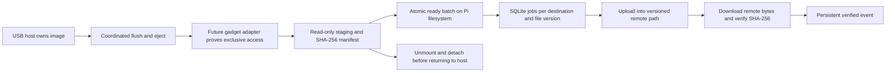

# Phase 1 architecture

The package in `src/raspi_cloud_sync_pro/` evolves Koseng's image → local transfer
directory → upload design into explicit boundaries. The original source remains
in `src/home/pi/`; Dropbox/SCP helpers are preserved with documented safety
quarantine. New code does not import those service loops.

| File | Implemented responsibility |
| --- | --- |
| `storage.py` | Fail-closed ownership model; requires clean host release, closed gadget/drained I/O, read-only access, and successful unmount/detach evidence |
| `staging.py` | Full recursive inventory, descriptor-based no-symlink reads, streamed SHA-256, source-change checks, space reserve, flushed files/manifest and atomic ready publication |
| `history.py` | SQLite schema version 1, transactional jobs and events, destination/version deduplication, atomic claims, OS worker lock, interrupted-job recovery and read-only history |
| `engine.py` | One attempt at a time; distinct upload/verification events; capped exponential backoff; network/metered gating; retain every source/staged file |
| `providers.py` | Explicitly enabled rclone adapter; bounded copies, immutable version paths and downloaded-content SHA-256 verification |
| `network.py` | Non-secret personal/enterprise profile validation and connectivity policy; no OS changes |
| `config.py`, `cli.py` | Strict planning schema, status/config checks and bounded read-only history output; no live backup command |

## Data flow

The ownership class serializes local transitions but is not a kernel lock,
cross-process device controller, or observation of host caches. Its booleans must
eventually come from a trusted hardware adapter. A fresh process starts unknown.
There is no automatic recovery to host ownership after an error.

## Staging contract

Only a trusted, exclusively owned, read-only source may be staged. The API is
intended for the future storage controller; no CLI can assert those conditions
for a real image. Service-owned source/destination ancestor directories must be
trusted and stable. No-follow descriptor traversal prevents source file/directory
symlinks being followed; it does not prevent a privileged process remounting or
replacing trusted roots. The gadget adapter remains essential.

Each `.incomplete` batch has `files/` plus `manifest.json`; successful publication
renames it to `.ready` after flushing files, directories and manifest. Failed
and incomplete batches stay on disk and cannot enter the queue. A low-space
preflight reserves 16 MiB by default; actual I/O errors still fail safely. Full
recursive inventory replaces upstream's timestamp cursor and two-directory
limit. A path/size/SHA-256 identifies file contents; timestamps alone do not.

## Jobs and remote versions

The queue has one job for each destination, relative path and SHA-256. Duplicate
snapshots do not repeat completed jobs. Changed content gets a distinct job and
`versions/<sha256>/<relative-path>` destination, retaining earlier versions.
Deleting a source never deletes remote data. Empty directories are staged but
have no upload jobs; empty files do have jobs.

States are queued → uploading → uploaded → verifying → verified, with retry
and failed outcomes. Each transition appends an event. A retry uses the same
version path; an interrupted attempt is never promoted to verified. Three
attempts and 30-second base backoff are defaults, capped at one hour. Syntax,
fatal and no-retry rclone errors fail; transient errors use the scheduler.
One `flock` worker holds the database lock through the attempt and recovery.
External writers must respect that lock; direct database edits are unsupported.

Rclone runs with argument arrays, an explicit protected config, one transfer/
checker, small buffers, a hard process timeout and no shell. Ambient `RCLONE_*`
overrides are removed except the encrypted-config password variable; inherited
proxy and CA settings are retained. Raw provider output is discarded. The adapter
uses [`copyto`](https://rclone.org/commands/rclone_copyto/) with `--immutable` and
`--checksum`, then [`checksum sha256 --download`](https://rclone.org/commands/rclone_checksum/)
against the manifest. Upload exit success alone never records verification.

## Limits and next integration work

There is no running daemon, gadget adapter, NetworkManager driver, or web server.
The queue retries whole files, not partial-upload sessions; large files may need
a later resumable provider implementation. Terminal failed jobs require future
explicit recovery tooling; re-enqueueing an identical version does not silently
reset them. Existing verified history describes a past check, not continuous
remote monitoring. Deleted/corrupted verified remote objects need a later audit
and repair workflow. Corrupt immutable destinations are not overwritten.

SQLite and manifests live on the Pi filesystem, separate from the USB image.
Use a restricted service-owned state directory; back up the database and staging
together when no worker is running. History schema migrations, all-disk-full
database recovery, cancellation, a long-running scheduler and durable hardware
ownership recovery remain work before deployment. File payloads are streamed;
manifest/job metadata scales with inventory size and still needs Pi benchmarking.
