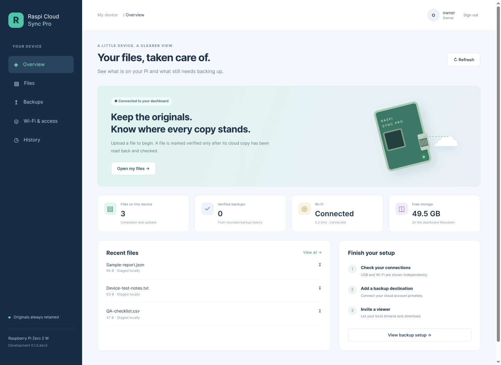

# Project progress

**Updated: 13 November 2026. Development build; no release published.**

This page records evidence, not a percentage estimate. Follow the
[development branch](https://github.com/rtariq2015/raspi-cloud-sync-pro/tree/development)
for the current source and [Actions](https://github.com/rtariq2015/raspi-cloud-sync-pro/actions)
for remote automated checks.

## Working on the Pi

- USB Ethernet management, home Wi-Fi and authenticated SSH access.
- Dashboard login with owner/viewer accounts, phone-friendly screens, QA-file
  upload, bounded text preview and downloads with byte/SHA-256 checks.
- Restricted dashboard service candidate with NoNewPrivileges and home/system
  filesystem restrictions. Login and authenticated file access also passed through
  a temporary public HTTPS tunnel; no router ports or VPN app were needed.
- Rust watcher fixture trial: 398,048-byte ARM64 binary, 1,796 KiB parent idle RSS,
  incomplete batches ignored and completed unchanged work not retriggered.

## Implemented and tested locally

- **145 Python tests and 4 Rust tests pass locally.** Python includes real rclone
  against temporary local storage; this is not a real cloud-account test.
- Completed-batch backup worker with per-destination jobs, retries, network policy,
  restart reconciliation and source retention. Disabled by default.
- Rust staged-file scheduler, upload wrapper, ARM64 cross-build and inactive unit.
- Non-secret enterprise Wi-Fi plans including PEAP/MSCHAPv2, anonymous identity,
  CA/server validation and EAP-TLS references. Planning does not activate Wi-Fi.
- USB/Samba ownership, staging, controller and recovery simulations from Phase 2.

## Being worked on

1. Replace the tested temporary HTTPS preview with a stable hostname/access policy,
   then accept an off-LAN phone connection.
2. Connect the Rust scheduler to the staged-file worker on the Pi using disposable
   local destinations before real cloud credentials.
3. Connect the dashboard to live queue/destination state.
4. Accept actual Samba file/lease locking while preserving USB management.

## Still requires acceptance

- Google Drive authorization and Koofr app-password setup with real test accounts.
- A phone on an outside network and physical Android PWA installation.
- Enterprise Wi-Fi on the intended network with its approved CA/server identity.
- Captive-portal sign-in for the Pi's own session; no universal automatic acceptance.
- USB power/endurance/recovery tests and installation on another physical Pi.
- A ready-to-flash appliance image and signed in-device updates with rollback.

Bluetooth setup/status is an optional future addition. It is not enabled by this
work. The chosen architecture stays lightweight: Rust watcher, Python control/UI,
and rclone/Samba for their protocols.

## Guides

- [What the product will do](PRODUCT_PLAN.md)
- [Dashboard and Android web app](DASHBOARD.md)
- [Backup worker](STAGED_WORKER.md)
- [Rust decision and measurements](RUST_EVALUATION.md)
- [Another Pi](REPLICATION.md)
- [Custom appliance image and updates](APPLIANCE_IMAGE.md)
- [Detailed test record](VALIDATION.md)

Original files remain retained. The current SD card has not been reflashed.
Main-branch merge and release publication still require owner approval.
